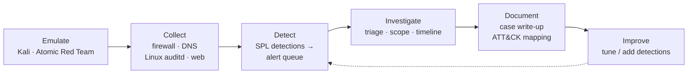

# SOC Casework

Security operations work from my homelab: attacks emulated from Kali against lab targets, detected in Splunk, investigated, and written up the way a SOC analyst documents an incident. Every case links to the detection that caught it, and every finding links to its evidence.

The lab these cases run in (network, Splunk, targets, and the detections as code) is documented in **[enterprise-homelab](https://github.com/J-DeMarzo/enterprise-homelab)**.

> **Status:** five detections are built and tested against recorded attacks. The first case, SSH brute force against a Linux host, is next ([roadmap](roadmap.md)).

## Cases

| Date | Case | ATT&CK | Verdict |
|---|---|---|---|
| *No cases yet. The first ones are SSH brute force and DNS tunneling ([roadmap](roadmap.md)).* | | | |

## Workflow



1. **Emulate:** run a technique from Kali or [Atomic Red Team](https://github.com/redcanaryco/atomic-red-team) against a target on the isolated lab VLAN.
2. **Detect:** a scheduled SPL detection writes a hit to the Splunk alert queue.
3. **Investigate:** triage, scope, and build the timeline from Splunk data.
4. **Document:** write the case from [`cases/TEMPLATE.md`](cases/TEMPLATE.md), with evidence alongside it.
5. **Improve:** tune the detection or add a new one, and link the change from the case.

## Detections

Detections are SPL, kept as code in [enterprise-homelab/detections](https://github.com/J-DeMarzo/enterprise-homelab/tree/main/detections) and deployed from there. Each one fired against a recorded test before it was added. A case here is the full investigation of that attack.

| Detection | ATT&CK | Case |
|---|---|---|
| [Denied probes toward Management](https://github.com/J-DeMarzo/enterprise-homelab/blob/main/detections/discovery-denied-probes-to-management.spl) | T1046 | Planned |
| [New device on the Management VLAN](https://github.com/J-DeMarzo/enterprise-homelab/blob/main/detections/initial-access-new-device-on-management.spl) | T1200 | — |
| [IoT device resolves a never-seen domain](https://github.com/J-DeMarzo/enterprise-homelab/blob/main/detections/command-and-control-new-iot-domain.spl) | T1071 | — |
| [DNS tunneling](https://github.com/J-DeMarzo/enterprise-homelab/blob/main/detections/exfiltration-dns-tunneling.spl) | T1071.004 | Planned |
| [Web probing against demarzo.dev](https://github.com/J-DeMarzo/enterprise-homelab/blob/main/detections/reconnaissance-web-probing.spl) | T1595.003 | — |

## The lab in brief

| | |
|---|---|
| **SIEM** | Splunk Enterprise, with a homemade alert queue (detections write to a summary index) so it keeps working on Splunk Free ([ADR 0006](https://github.com/J-DeMarzo/enterprise-homelab/blob/main/docs/adr/0006-soc-focus-with-splunk.md)) |
| **Attacker** | Kali on the isolated Security VLAN (40) |
| **Targets** | `linux-victim` (SSH, auditd, journald) and `vuln-web` (DVWA, Apache access logs), rebuilt from a script on demand |
| **Log sources** | Omada gateway ACL events, Technitium DNS query logs, Linux journald and auditd, Apache and Caddy access logs, Proxmox API access |
| **Isolation** | Default-deny between VLANs, verified with a [before/after test table](https://github.com/J-DeMarzo/enterprise-homelab/blob/main/docs/architecture/firewall-rules.md#test-results) |

Detail: [SIEM design](https://github.com/J-DeMarzo/enterprise-homelab/blob/main/docs/architecture/siem.md) · [network](https://github.com/J-DeMarzo/enterprise-homelab/blob/main/docs/architecture/network.md) · [target rebuild runbook](https://github.com/J-DeMarzo/enterprise-homelab/blob/main/docs/runbooks/rebuild-targets.md)

## Skills demonstrated

- **Alert triage and investigation** in Splunk, with the SPL behind every finding
- **Incident documentation:** timelines, indicators, scope, and response recommendations
- **MITRE ATT&CK** mapping
- **Detection engineering:** writing, testing, and tuning SPL detections against real lab data
- **Attack emulation** with Kali and Atomic Red Team
- **AI-assisted triage, checked against the evidence:** a first pass by a local LLM, so no log data leaves the lab, with every claim verified in the case

## Repository layout

```
cases/
  YYYY-MM-DD-short-name/
    README.md      the case write-up
    evidence/      screenshots and exported search results
  TEMPLATE.md
roadmap.md         planned cases
scripts/
  new-case.sh      creates a case folder from the template
  llm-triage.sh    local-LLM first pass on a Splunk export
```

## Security note

This repo is public. All attack activity is confined to an isolated lab VLAN, against systems I own. Evidence contains private RFC 1918 addresses and the internal lab domain, which aren't reachable from outside. It contains no credentials, tokens, keys, or public IPs. Commits are scanned with [gitleaks](https://github.com/gitleaks/gitleaks).
